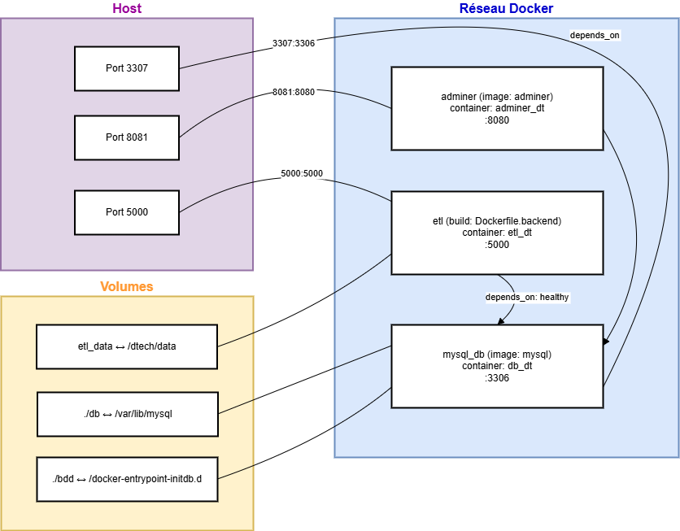

# Readme pour la dockerisation du projet


L'ensemble du projet est containeurisé par Docker et orchestré par Docker-compose, avec les images suivantes :

- mysql 8 pour la base de données (container db_dt)
  [dockerhub/mysql](https://hub.docker.com/_/mysql)
- adminer pour visualiser la base (container adminer_dt)
  [dockerhub/adminer](https://hub.docker.com/_/adminer)
- python:3.12-slim pour le code (container etl_dt)
  [dockerhub/python](https://hub.docker.com/_/python)

Le back (script etl) et le front (flask) sont dans le même container.

Les entités communiquent à travers les ports internes du container.

Les ports 3306 (MySQL) et 8080 (Adminer) sont exposés à l'extérieur du container en 3307 et 8081 respectivement,

Les pages HTML générées par Flask sont accessibles sur le port 5000.



## Mode d'emploi

1- Démarrer les containers en arrière plan

```bash
docker-compose up -d --build
```

Les scripts ne sont pas lancés automatiquement lors du démarrage des containers, car l'absence de données ou un accès trop rapide à la base de données peuvent engendrer des erreurs.

2- Déplacer les données depuis le volume /data local vers le répertoire /data du container

```bash
docker cp ./data/. etl_dt:/dtech/data/
```

3- Lancer le traitement etl sur les données du répertoire /data du container

```bash
docker-compose exec etl python3 etl.py
```

les étapes 2 et 3 peuvent être recommencées lors de l'ajout de nouvelles données dans /data

5- Lancer le front (accesible dans le navigateur port :5000) dans un nouveau terminal

La récupération des données n'est pas dynamique (pas d'API), donc le serveur front doit être relancé en cas de nouvelles données pour afficher une page à jour. Le front fait des requêtes directes à la BDD pour générer le tableau des stocks.

```bash
docker-compose exec etl python3 ./front/front.py
```

Rendez-vous sur la V2 pour l'API !
